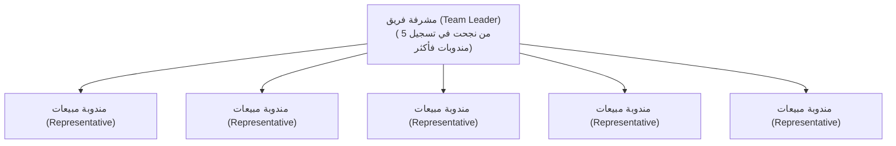

# 🌸 نظام التسويق بالعمولة والشجرة الهرمية للمندوبات والماميز (Affiliate System Spec)

> **الهدف**: تشغيل شبكة واسعة من ربات البيوت والمندوبات للبيع من المنزل بعمولات مجزية مع ترقية تلقائية للمتميزات لقيادة الفرق.

---

## 🏗️ 1. الهيكل الشجري والرتب (Hierarchy & Roles)

---

## ⚡ 2. قواعد التسجيل والترقية التلقائية (`affiliate_tree_agent.js`)

1. **تسجيل مندوبة جديدة (`registerAffiliate`)**:
   - يتم طلب: (الاسم الثلاثي - المحافظة - رقم الهاتف/الواتساب).
   - إمكانية تحديد رقم المشرفة التابعة لها (`supervisor_phone`).
   - يُسجل الحساب بالرتبة الافتراضية: `Representative`.
   - يتولد لها كود عمولة فريد.

2. **الترقية التلقائية لمشرفة فريق (`Team Leader`)**:
   - عند نجاح أي مشرفة في ضم **5 مندوبات نشطات** تحت إشرافها (`COUNT >= 5`):
   - يتم ترقية رتبتها في قاعدة البيانات فوراً إلى: `Team Leader`.
   - تحصل على نسبة عمولة إضافية على إجمالي مبيعات فريقها بالكامل.

---

## 💰 3. العمولات ونقاط المبيعات
- يتم تسجيل كل طلبية تتم عبر كود المندوبة في جدول `orders`.
- يتم احتساب قيمة العمولة وتحديث رصيد `total_commissions` و `sales_count` في جدول `affiliates`.
- التوجيه الآلي الفوري: أي استفسار يتضمن كلمات مثل `[شغل من البيت, عمولة, أونلاين, زيادة دخل, ماميز]` يتم تحويله آلياً لنظام التسجيل بالعمولة دون إرسال أسعار الجملة للشركات.

