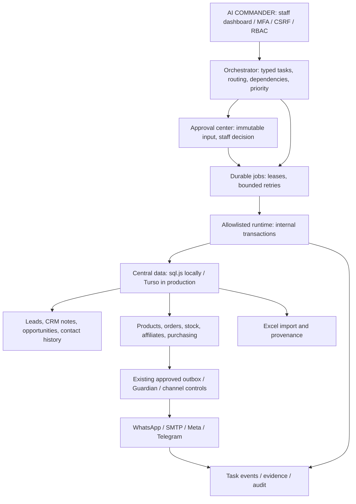

# AI COMMANDER 2 — technical delivery plan

Date: 2026-11-28. Source: the supplied MASTER TECHNICAL DEVELOPMENT SCRIPT v2 and architecture image.

This is the current plan for this change. It defines the twelve requested design deliverables before implementation. Implementation and local validation are recorded separately in `implementation.md`. A saved draft, a queued job and a provider delivery are different outcomes.

## 1. Architecture

Reuse CommonJS, Node >=22.20, Express 5, additive SQLite-compatible migrations, `lib/storage.js`, `lib/queue.js`, staff permissions and existing outbox. PostgreSQL in the request is a recommendation: retain the explicitly mandated sql.js local engine and current Turso production design. Separate web/worker processes must use Turso; local sql.js has one owner and cannot be shared across processes. No new framework, fake connector or second operational database.

## 2. Agent responsibilities and permissions

Stable keys preserve existing controls and historical audit entries. The request enumerates 01–20 (20 total), despite its introduction saying manager +15 +5. Use the enumerated list. Guardian remains a shared policy service, outside the twenty business agents.

| # | Key | Responsibility | Available boundary / development needed |
|---|---|---|---|
| 01 | manager | Coordination and reporting | Existing reminders; add persisted management reports and task supervision |
| 02 | ads | Advertising content | Existing approved drafts; platform publication remains separate |
| 03 | marketing | Segmentation and strategy | Existing sector campaign drafts; attribution and experiments later |
| 04 | sales | Opportunities and follow-up | Existing lead drafts; CRM opportunities added below |
| 05 | orders | Order lifecycle | Existing approved confirmation, stock reservation and staff fulfillment |
| 06 | inventory | Stock monitoring | Existing recommendations; report stock provenance, never invent balances |
| 07 | support | Complaints | Existing tickets and reviewed replies; SLA automation later |
| 08 | affiliate | Mamiz network | Existing tree and commissions; configurable versioned rules later |
| 09 | refinement | Data quality | Existing proposed, optimistic corrections; never silently merge/delete |
| 10 | aggregator | Order intake | Existing CSV/channel mapping; final order requires existing approval |
| 11 | outreach | Campaign planning | Existing proposals; channel agents perform actual send |
| 12 | whatsapp | WhatsApp channel | Existing session service; official Business Platform and real smoke test still required |
| 13 | email | Email channel | Existing SMTP/outbox; IMAP, bounce/event verification still required |
| 14 | social | Social inbox | Existing signed Meta/Telegram intake and approved replies |
| 15 | scraper | Lead research | Existing standalone research; source review and provider validation remain necessary |
| 16 | pricing | Profitability | Add deterministic simulation using explicit cost and current catalog price; no price write |
| 17 | bi | Business intelligence | Add stored reports computed from operational records; no fabricated ROI |
| 18 | crm | Customer relations | Reuse unique leads; add notes and sales opportunities with history |
| 19 | distribution | Distribution development | Add sector coverage counts; geographical coverage unavailable without region data |
| 20 | procurement | Supply chain | Add stock-needs report; use existing purchasing workspace for approved purchasing |

Read tools cannot write domain data. Internal CRM updates can execute automatically. Destructive, financial, price, commission and external actions require explicit human approval and a specific allowlisted implementation. New task types cannot be supplied as arbitrary SQL, JavaScript, prompts or URLs. Unsupported capabilities are rejected.

## 3. Database schema

Existing tables: `jobs`, `agent_controls`, `agent_tasks` (legacy proposals), `audit_log`, `leads`, `outbox`, `inbound_messages`, `marketing_campaigns`, `store_orders`, `inventory`, `inventory_history`, `price_list_items`, `affiliates`, `purchase_orders`, `suppliers`, `goods_receipts`.

Add migration 17:

- `commander_tasks`: UUID, unique idempotency key and request hash, created_by, creator_agent, assigned_agent, type, input JSON, source, expected outcome, attachments, confidence, priority, due_at, expires_at, dependency ID, status, attempts, result JSON, error, reviewed_by/at, created_at/updated_at. Status CHECK enforces the published state vocabulary.
- `commander_events`: sequence ID, task FK, actor, from/to status, details JSON, timestamp. Includes the immutable approval snapshot and handoff links.
- `crm_notes`: task ID unique, lead FK, note, creator, timestamp. A completed note task proves a database write, never customer contact.
- `crm_opportunities`: ID, lead FK, title, stage, value_minor, owner, source task ID unique, timestamps. Contact consent, opt-out and last-contact fields remain exclusively in existing lead/channel workflows.

Task dependencies refer to an already existing task, preventing cycles. Result and domain effects commit in the same transaction. Retries retain task IDs and inputs. New records do not alter historical legacy proposal meanings.

## 4. API specifications

All routes under `/api/v1/admin/commander`, permission `agents` (currently admin only), mutation CSRF required, existing origin checks apply. Bound lists to 100 and validate inputs before persistence.

| Method | Route | Contract |
|---|---|---|
| GET | `/overview` | Task counts, overdue, failures, latency, per-agent success, supported types, latest tasks |
| POST | `/tasks` | `Idempotency-Key`, type, input, priority, dueAt, expiresAt, dependsOn, source, expectedOutcome; return persisted task |
| GET | `/tasks/:id` | Task, result, input and ordered state/approval history |
| POST | `/tasks/:id/review` | decision approved/rejected; reviewable state only; bind decision to immutable input |
| POST | `/tasks/:id/cancel` | Cancel waiting/failed tasks; no reversal of completed work |
| POST | `/tasks/:id/retry` | Failed task only, bounded attempts, same input/key; no external replay |

The browser never chooses an assigned agent or downgrades an approval policy. Unknown types/fields are rejected. Existing legacy proposal review and outbox routes remain the sole path to currently implemented external actions.

## 5. Workflow definitions

`NEW → ASSIGNED → RUNNING → [AWAITING_APPROVAL → APPROVED] → EXECUTING → COMPLETED`. Also FAILED, REJECTED, CANCELLED, EXPIRED. Only documented transitions are allowed. Internal read/report tasks pass RUNNING/EXECUTING without a human gate. A proposal-only task must say what was saved; it cannot claim publication or delivery.

The new runtime executes bounded database-only operations transactionally. Queue priority orders commander jobs while leaving existing jobs at normal priority. Failed dependencies block children; completed dependencies unlock them; cancelled/rejected/expired dependencies cancel children. Staff can inspect the dependency and events. Failure records attempts and a sanitized error; backoff belongs to the durable queue. Manual retries create a fresh job generation within the same bounded task attempt budget. Global and per-agent pause gates are checked at execution and again before committing an operation.

Lead journey: existing research/import → reviewed data-quality proposal → unique lead record → CRM opportunity → marketing draft → outreach proposal → staff approval → channel outbox/Guardian → provider evidence → sales and order workflows → BI report. Do not label all steps automated while a provider or data source remains unavailable.

## 6. Approval matrix

| Action | Policy | Evidence |
|---|---|---|
| Reports, classification previews, price simulation | Automatic, bounded reads | Stored inputs, source tables, as-of time, output |
| CRM note / opportunity creation | Internal automatic | Unique task-linked persisted record |
| CRM opportunity stage/value update | Human review in new engine | Exact opportunity input and staff decision |
| Campaign send / publication | Existing staff review + Guardian + channel checks | Provider ID / accepted response; delivered only after delivery event |
| Prices, discounts, commissions | Human only; no new write tool | Versioned approval needed before future implementation |
| Purchase orders | Existing purchasing administrator approval | Purchase order and goods-receipt records |
| Payments, final invoices, customer deletion/merge | Unsupported in new runtime | Must build reviewed domain operation first |

Agents cannot submit approval decisions as a human. HTTP review actor is taken exclusively from the authenticated session.

## 7. Integration documentation

Existing modules: `lib/channels/`, `lib/integrations/`, `lib/integration-settings.js`, `lib/mailer.js`, `lib/outbox.js`. Preserve 30-day contact suppression, Cairo 09:00–18:00, five WhatsApp messages followed by 30-minute rest, opt-out and sector/price isolation. Saved credentials mean configured, never verified-connected. Operational proof must include last successful provider operation and error history. Keep tokens in environment/secret manager or the existing encrypted store. No real sends, paid requests or scraping are needed for local tests.

Excel already has import paths and provenance in `price_list_items` and imported leads. Production dependencies exclude the legacy `xlsx` development dependency: do not claim deployed XLSX parsing without a supported safe parser/bundle decision. Retain preview/apply import semantics. Record unknown data as missing, not zero-cost profitability or made-up attribution.

## 8. Agent permissions matrix

Business agents 01–15 retain their existing allowlists. New keys are controls for real tools only: manager→manager.report, pricing→pricing.simulate, bi→bi.report, crm→crm.note/create_opportunity/update_opportunity, distribution→distribution.report, procurement→procurement.report. New keys start individually paused. The global switch retains its current value. No tool can impersonate another agent or staff member. Pricing/procurement results are sensitive and use admin-only `agents` access.

## 9. Dashboard design

Extend `/store/agents` using the existing Arabic RTL shell. Follow the supplied blue/teal architecture hierarchy: commander header, task workbench, task queue and evidence below. Colors: commander blue #194f7d, pale teal #deece9, emerald #064e3b, ink #0f172a, border #cbd5e1. Retain Cairo/Tahoma for Arabic and existing button/focus treatment. Use a labelled task selector and type-specific form, priority and deadline, then a compact task list with status, owner, attempts, deadline and inspect/review/retry/cancel actions. Expand immutable details and evidence with text nodes, never HTML injection. Explain empty, paused and failed states. Mobile tables scroll; controls remain keyboard accessible. No decorative fake live metrics.

## 10. Test cases

Use in-memory sql.js and synthetic data. Cover migration replay, type routing and allowlist rejection, immutable approval, RBAC/CSRF, priority, scheduling, dependencies, global/per-agent pause, expiry, duplicate keys and key conflicts, bounded retries, transactional failure rollback, no duplicate CRM record after replay, pricing integer arithmetic, report reconciliation, stock provenance, and event history. Run existing `npm test` and `npm run check`. Provider smoke tests remain outstanding until isolated provider credentials and test recipients exist; passing mocks is not provider verification.

## 11. Deployment plan

Run checks locally, back up destination, migrate through 17 on isolated staging, deploy compatible web and worker together, inspect new controls while paused, enable only tested tools, exercise synthetic CRM/report tasks, then validate actual provider channels separately before commercial activation. Use current Turso/Vercel/worker deployment in `../production-readiness.md`. Do not perform an unrequested production rollout. No live migration is needed to validate this change locally.

## 12. Backup and recovery

Existing `lib/backup.js` snapshots schema and all tables transactionally and encrypts with AES-256-GCM; new tables are included automatically. Use `npm run backup` / `restore:check`, stable secret vault keys and an isolated restore destination. Pause agents and workers, freeze writes, preserve incident database, reconcile the verified restore, switch credentials only after operational approval. Never overwrite production data or reverse physical deliveries from a task status change. Retain existing recovery targets and rehearse with the real provider.
